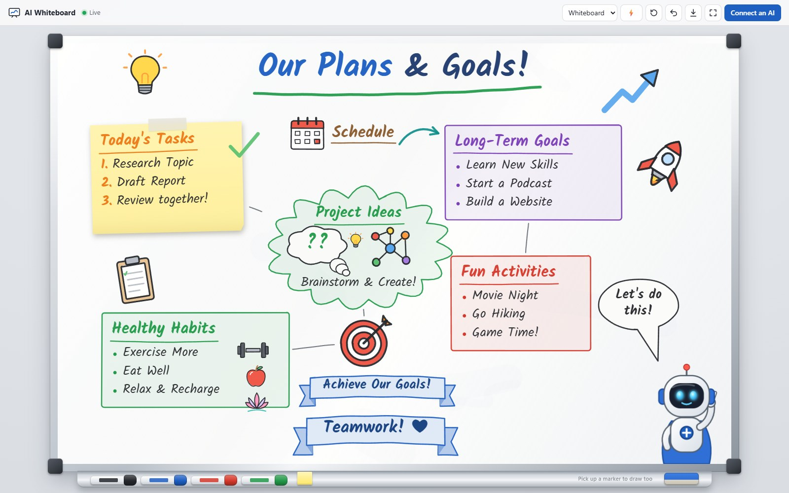
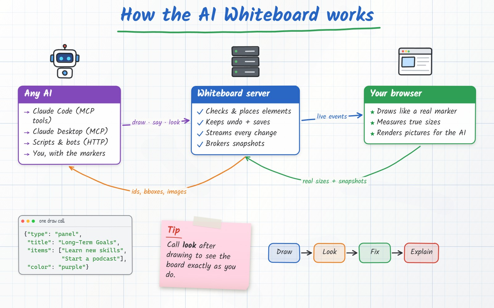
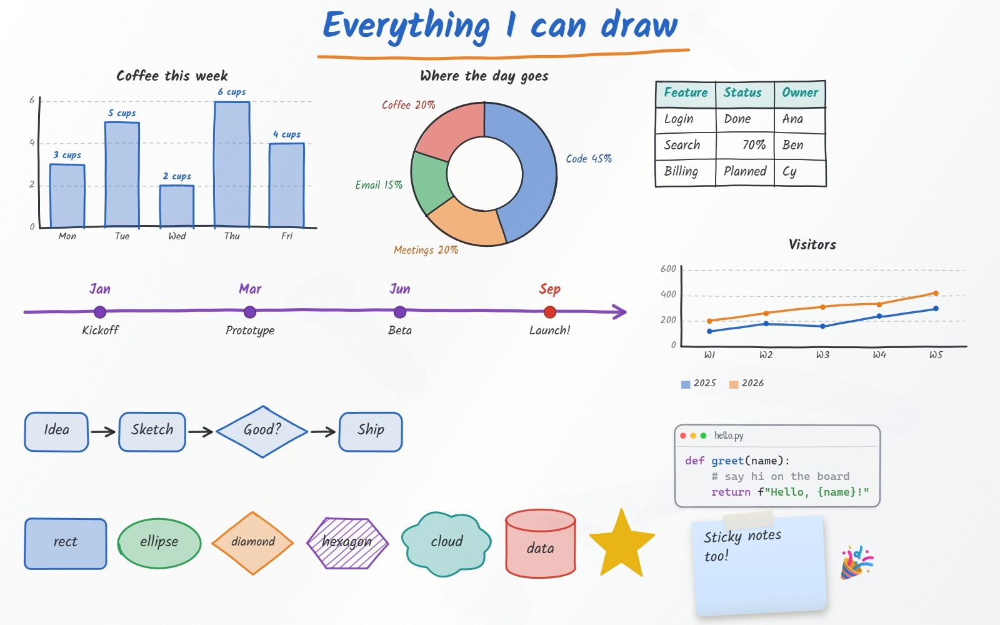
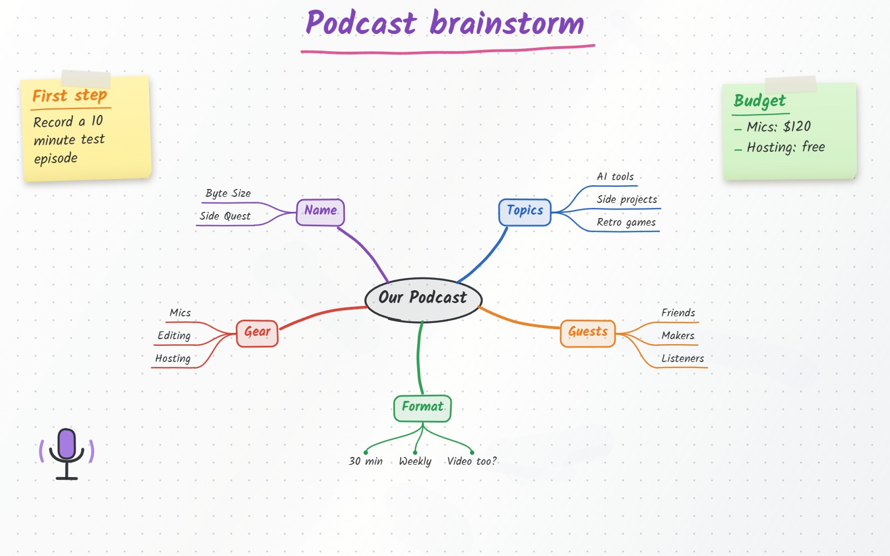
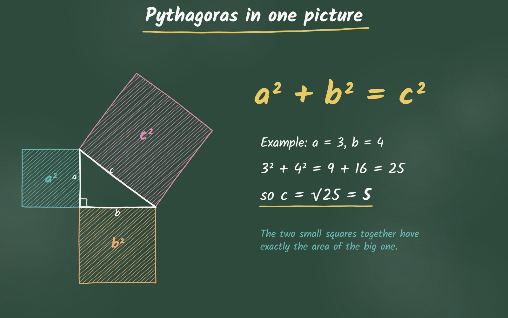
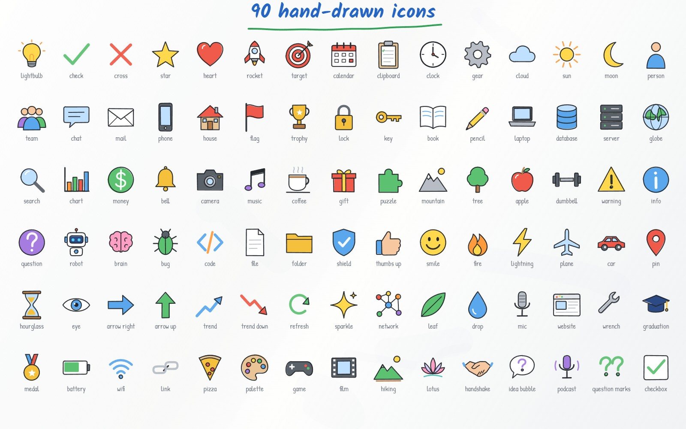

# AI Whiteboard

**A live, hand-drawn whiteboard that AIs draw on while you watch.**

An AI sends simple JSON ("a panel titled *Long-Term Goals* with three bullets",
"an arrow from the server to the browser", "a bar chart of these numbers") and
the board in your browser draws it with a marker animation: a pen moves as it
writes, an eraser wipes, and a robot mascot talks. The AI can then **look** at
the board (it gets a picture back) and fix what it drew.



* **No dependencies:** standard-library Python plus a static web page.
* **Works with any AI:** an **MCP server** for Claude Code, Claude Desktop and
  other MCP clients, a plain **HTTP API** for anything that can make a request,
  a **Python client** and a **CLI**.
* **30 element types and 90 hand-drawn icons:** sticky notes, panels, banners,
  speech bubbles, charts, tables, mind maps, flowcharts, timelines, code blocks,
  shapes and more.
* **You can draw too:** pick up a marker, the eraser or a sticky note from the
  tray. Your strokes are on the board for the AI to see.

## Quick start

```bash
git clone https://github.com/alby13/AI-Whiteboard.git
cd AI-Whiteboard
python -m whiteboard serve --open      # board at http://127.0.0.1:8765
python -m whiteboard demo plans        # draw the demo above
```

Requires Python 3.10+. `pip install .` also installs `ai-whiteboard` and
`ai-whiteboard-mcp` commands.

## Demos

`python -m whiteboard demo <name>` draws one of these (each animates in, stroke by stroke):

| `explain`: how the whiteboard works | `showcase`: charts, tables, flows, shapes, code |
| --- | --- |
|  |  |
| **`brainstorm`: a mind map** | **`lesson`: a chalkboard maths lesson** |
|  |  |

`plans` is the board at the top, and `icons` draws every icon with its name:



## Let an AI draw on it

### Claude Code

The repo includes a `.mcp.json`, so Claude Code offers the `whiteboard` server
when you open the folder. From anywhere else:

```bash
claude mcp add whiteboard -- python /path/to/AI-Whiteboard/whiteboard/mcp_server.py
```

### Claude Desktop and other MCP clients

```json
{
  "mcpServers": {
    "whiteboard": {
      "command": "python",
      "args": ["/path/to/AI-Whiteboard/whiteboard/mcp_server.py"]
    }
  }
}
```

The MCP server starts the board server in the background if it is not
running, and opens the board in your browser the first time something is drawn
(set `WHITEBOARD_NO_BROWSER=1` to turn that off).

| Tool | What it does |
| --- | --- |
| `draw` | Draw one or more elements (its description holds the element reference) |
| `look` | Returns a picture of the board, so the AI sees what you see |
| `get_board` | Ids, labels and bounding boxes of everything, plus a map of free space |
| `update` | Move (`x`/`y` or `dx`/`dy`), restyle or re-word elements |
| `erase` / `clear_board` / `undo` | Remove things (with an eraser animation) |
| `say` | The mascot says something in a speech bubble (optional `pause` holds the drawing) |
| `pause` | Hold the drawing for a few seconds, to pace a presentation |
| `point_at` | Circle an element or spot, with a caption |
| `board_settings` | Background (whiteboard, grid, dots, chalkboard, blueprint), size, mascot |
| `save_board` / `load_board` | Keep boards by name |
| `open_whiteboard` / `guide` | Open the board; full reference with every icon name |

### Any AI with HTTP or a shell

```bash
curl -X POST http://127.0.0.1:8765/api/draw -H "Content-Type: application/json" \
  -d '{"elements":[{"type":"title","text":"Hello from an AI!"}]}'
```

`GET /api/guide` returns the reference written for AIs. Other endpoints:
`/api/board`, `/api/update`, `/api/erase`, `/api/clear`, `/api/undo`,
`/api/say`, `/api/pause`, `/api/point`, `/api/settings`, `/api/save`,
`/api/load`, and `/api/snapshot?format=png|jpeg&width=1600` (needs the board
open in a browser). Send an `X-Agent: <name>` header and the board shows
"<name> is drawing...".

### Python

```python
from whiteboard import Whiteboard

wb = Whiteboard(agent="my-bot")
wb.draw({"type": "title", "text": "Sprint plan"},
        {"type": "panel", "id": "todo", "title": "To do", "items": ["API", "Docs"], "color": "orange"},
        {"type": "sticky", "right_of": "todo", "text": "Ship Friday!", "color": "pink"})
wb.say("Here's the plan!")
open("board.png", "wb").write(wb.snapshot())
```

### CLI

```bash
python -m whiteboard draw '{"type":"icon","name":"rocket","x":700,"y":400,"size":160}'
python -m whiteboard run my_board.json     # a list of elements and ops
python -m whiteboard board                 # what's on the board + free-space map
python -m whiteboard look board.png
python -m whiteboard say "Done!"
python -m whiteboard erase rect1 | clear | undo | stop
```

## Drawing reference (short)

The board is 1600 x 1000, origin top-left. Most elements take `x, y`
(top-left) and `w, h`; give `cx, cy` to centre on a point, or leave the
position out and the board finds free space. `"below": "<id>"` (also `above`,
`right_of`, `left_of`) places an element next to another one.

| Type | Example |
| --- | --- |
| `title` | `{"type":"title","text":"Our Plans & Goals!","underline":"green"}` |
| `text` | `{"type":"text","x":100,"y":200,"text":"Hello **world**","width":400,"highlight":"yellow"}` |
| shapes | `rect`, `ellipse`, `circle`, `diamond`, `triangle`, `hexagon`, `star`, `cloud`, `cylinder`, `parallelogram` with `label`, `fill`, `fill_style: soft/solid/hachure` |
| `line`, `arrow` | arrows connect element ids and follow them: `{"type":"arrow","from":"a","to":"b","label":"yes","route":"curve"}` |
| `sticky`, `panel`, `list` | titled notes and bullet lists (`bullets: dot/number/check/box/arrow/star`, nested items, `done`) |
| `bubble`, `banner` | speech/thought/shout bubbles; ribbon banners |
| `icon`, `emoji`, `image` | 90 icons (`python -m whiteboard demo icons` shows them all) |
| `table`, `chart` | tables; bar/line/area/pie/donut charts |
| `code` | syntax-coloured code block |
| `frame`, `timeline`, `mindmap`, `flow` | sections, timelines, mind maps, step-by-step flows |
| `highlight`, `path` | highlighter over anything; any SVG path |

`python -m whiteboard guide` prints the full reference.

## Presenting and recording

Open `http://127.0.0.1:8765/?present=1` to hide the top bar (`H` toggles it,
`F` goes fullscreen); add `&speed=0.5` for slower, more deliberate handwriting.
Scripts pace themselves with `{"op": "pause", "seconds": 2}` and
`{"op": "say", "text": "...", "pause": 3}`, so the board waits while the mascot
talks. The viewer also has replay, PNG export and drawing-speed buttons.

## How it works

```
AI ──MCP / HTTP──▶ whiteboard server ──live events (SSE)──▶ browser viewer
 ▲                  (state, placement,                       (hand-drawn renderer,
 └── ids, bboxes,    undo, saves)        ◀── real sizes,      animation, snapshots)
     pictures                                snapshots
```

* `whiteboard/server.py` keeps the board, validates and places elements, and
  streams every change to open viewers over Server-Sent Events.
* The browser is the renderer (`whiteboard/static/render.js`): each element
  compiles into marker strokes, fills and handwriting, seeded so its wobble
  never changes. The viewer reports each element's real size back to the
  server and renders the pictures that `look` returns.
* Boards are saved to `boards/` in a source checkout (`~/.ai-whiteboard`
  when installed, or `$WHITEBOARD_DATA`).

The server listens on 127.0.0.1 only, accepts only JSON POSTs and checks the
Host header, so other web pages cannot draw on or read your board.

## Tests

```bash
pip install ".[dev]"
python -m pytest
```

## License

MIT
